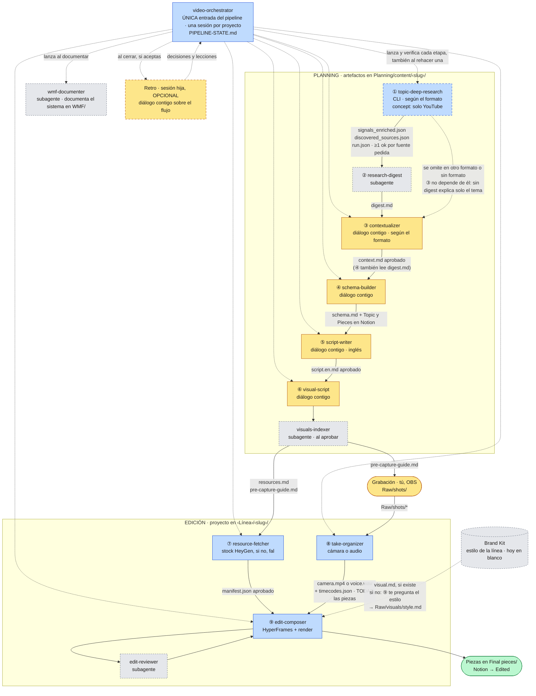

# WORKFLOW — el flujo completo, de tema a pieza editada

Mapa único del pipeline: quién hace cada etapa, qué entra, qué sale y dónde se detiene. El detalle
interno de una etapa vive en su `SKILL.md` (es lo que Claude ejecuta); aquí no se copia.

## Diagrama

**Leyenda:** amarillo = tú decides en diálogo · azul = automático (solo te llama en sus gates) · gris
punteado = subagente (tarea corta, sin sesión propia) · verde = fin del pipeline. Línea punteada =
lanza o se omite.

## Cómo avanza (los gates)

| Gate | Dónde | Quién lo cruza |
|---|---|---|
| Investigación válida | ① → ② | Automático: `run.json` con al menos un `ok` por cada fuente pedida; si no, ① queda `bloqueada` con el motivo. El orquestador no reutiliza una investigación anterior sin `run.json` o con una fuente pedida en 0 |
| Aprobar contexto | ③ → ④ | **Tú**, explícito: dices que ya entendiste y `context.md` queda sellado (`Estado: aprobado <fecha>`). Cada `[UNVERIFIED]` se verifica o tú decides dejarlo fuera |
| Aprobar esquemas | ④ → ⑤ | **Tú**, explícito. Al aprobar se crean Topic + Pieces en Notion (`In Production`) |
| Aprobar guion | ⑤ → ⑥ | **Tú**. Un `[UNVERIFIED]` no puede sobrevivir a la aprobación |
| Aprobar visuales | ⑥ → ⑦ y grabación | **Tú**. Al aprobar salen solas las dos listas derivadas |
| "Ya grabé" | grabación → ⑧ | **Tú** |
| Aprobar video generado | dentro de ⑦ | **Tú**. Es la única categoría cara; imagen y SFX se aprueban en bloque |
| Aclarar tomas ambiguas | dentro de ⑧, entre tomas sin marca | **Tú**. ⑧ pregunta, con su crítica de entrega |
| Acordar el estilo | dentro de ⑨, si el Brand Kit no tiene `visual.md` (hoy, siempre) | **Tú**. ⑨ se detiene y pregunta; lo acordado queda en `Raw/visuals/style.md` |
| Escalar un punto crítico | dentro de ⑨, tras 3 intentos de `edit-reviewer` | **Tú**. ⑨ deja de reintentar y te lo escala |
| Precondición dura de ⑨ | ⑦ + ⑧ → ⑨ | Automático: `manifest.json` aprobado **y** cámara/audio + tiempos de todas las piezas |
| Retro del flujo (opcional) | tras ⑨, al cerrar el proyecto | **Tú**. Es la única pregunta del orquestador: si aceptas, abre una sesión de retro y su reporte pasa a `wmf-documenter` |

Fuera de esos gates, las etapas automáticas se lanzan solas cuando la anterior queda **verificada**: el
orquestador comprueba el archivo, no solo el reporte de la hija.

## Catálogo de etapas

"Requiere" = si falta, la etapa se detiene. "Usa" = mejora el resultado pero no es obligatorio.

| # | Etapa | Tipo | Requiere | Usa | Produce | Fuente de verdad |
|---|---|---|---|---|---|---|
| ① | topic-deep-research | automática, según el formato (concept: solo YouTube) | un string de tema | — | `signals_enriched.json`, `discovered_sources.json`, `run.json` | [STAGE.md](../Planning/code/topic-deep-research/STAGE.md) |
| ② | research-digest | subagente | los dos JSON de ① | — | `digest.md` | [agente](../.claude/agents/research-digest.md) |
| ③ | contextualizer | conversacional, según el formato (news: en corto) | un tema | `digest.md` | `context.md` | [SKILL](../.claude/skills/contextualizer/SKILL.md) |
| ④ | schema-builder | conversacional | un tema | `context.md`, `digest.md` | `schema.md`, Topic + Pieces en Notion | [SKILL](../.claude/skills/schema-builder/SKILL.md) |
| ⑤ | script-writer | conversacional (inglés) | `schema.md` | `context.md`, `digest.md` | `<pieza>/script.en.md` con `Delivery: on-camera \| voice-only` | [SKILL](../.claude/skills/script-writer/SKILL.md) |
| ⑥ | visual-script | conversacional | `script.en.md` aprobado + `schema.md` | — | `<pieza>/visuals.md` → `resources.md`, `pre-capture-guide.md` | [SKILL](../.claude/skills/visual-script/SKILL.md) |
| ⑦ | resource-fetcher | automática, con gate de video | listado de recursos | `manifest.json` previo | `Raw/resources/<ID>.*`, `manifest.json` | [SKILL](../.claude/skills/resource-fetcher/SKILL.md) |
| ⑧ | take-organizer | automática, aclara ambigüedades contigo | `Raw/shots/*` + `script.en.md` y `visuals.md` aprobados | — | `camera.mp4` o `voice.wav` + `timecodes.json` por pieza | [SKILL](../.claude/skills/take-organizer/SKILL.md) |
| ⑨ | edit-composer | automática; te pregunta el estilo si el Brand Kit no tiene `visual.md` y te escala un punto crítico tras 3 intentos | `manifest.json` aprobado + ⑧ de todas las piezas + `visuals.md` + un estilo (`visual.md` del Brand Kit o `Raw/visuals/style.md`) | — | piezas en `Final pieces/`, Notion `Edited` | [SKILL](../.claude/skills/edit-composer/SKILL.md) |

Subagentes sin sesión propia: `visuals-indexer` ([agente](../.claude/agents/visuals-indexer.md)),
`edit-reviewer` ([agente](../.claude/agents/edit-reviewer.md)) y `wmf-documenter`
([agente](../.claude/agents/wmf-documenter.md)). `script-transcreator` está **parado**
([archivado](reference/parked/script-transcreator.md)): no hay pista en español.

Orquestación: [video-orchestrator](../.claude/skills/video-orchestrator/SKILL.md) es la **única entrada
del pipeline**. Ninguna skill de etapa se invoca suelta, y rehacer una etapa también nace ahí: relanza la
hija como revisión y marca `desactualizada` las etapas posteriores que leen lo que cambió (no las relanza
sola). Lanza cada etapa como sesión hija limpia: no abres ni nombras chats, entras a las conversacionales
(③ ④ ⑤ ⑥) y las automáticas (① ⑦ ⑧ ⑨) solo te llaman en sus gates. La investigación es solo la etapa ① y
corre según el formato ([FORMATS](FORMATS.md)); ④ no investiga: si ① no corrió y la quieres, pídesela al
orquestador. Tampoco explica: si necesitas que te expliquen el tema o lo investigado, en cualquier sesión,
el orquestador lanza o relanza ③. Cada skill de etapa abre con un *Contrato de la
etapa* (tipo, brief, lee, escribe, no hace, habla con Santiago, termina cuando) y las reglas comunes de
toda sesión hija; ese detalle vive en la skill, no aquí.

## Principios que sostienen el diseño

1. **Una etapa depende de artefactos, nunca de otra etapa.** Se pasan archivos, no conversación; por
   eso cada una arranca en frío, como sesión hija limpia del orquestador.
2. **La autoría creativa es tuya.** Claude es coach y crítico a la vez. **Critica siempre**, sin que lo
   pidas: comprensión del tema en `contextualizer`, estructura en `schema-builder`, retención y claridad
   en `script-writer`, lo creativo en `visual-script`, la entrega al elegir entre tomas en
   `take-organizer`. **Propone solo si lo pides**:
   líneas, tomas, generaciones, estructuras (única excepción: avisa en una línea si ve una estructura
   mejor y pregunta si la quieres). Lo derivado de algo ya aprobado se automatiza.
3. **Planning decide qué se ve; Edición decide cómo se ve.** Ninguna etapa de Planning especifica
   color, tipografía, adorno ni transiciones.
4. **Stock antes que generar.** Se genera con IA (`fal`) solo si no hay match razonable. Higgsfield es
   el respaldo; Magnific no se usa.
5. **El estilo no vive en el workflow.** Las skills leen el Brand Kit de la línea de contenido. Sin
   `visual.md` no hay estilo por defecto: ⑨ lo pregunta.
6. **Idioma:** audiencia y video en inglés; el diálogo de `script-writer` es en inglés, el resto en
   español.
7. **Los temas los elige Santiago.** No hay descubrimiento ni clasificación automática de temas.

Qué etapas corren según el tipo de video: [FORMATS](FORMATS.md). Qué archivo produce cada una y dónde
vive: [ARTIFACTS](ARTIFACTS.md).
